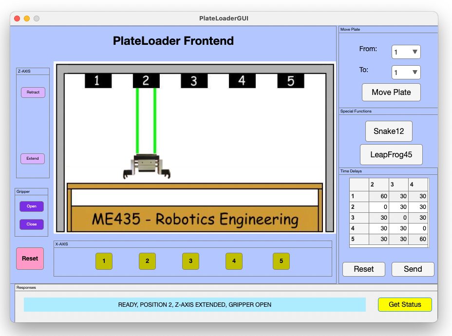
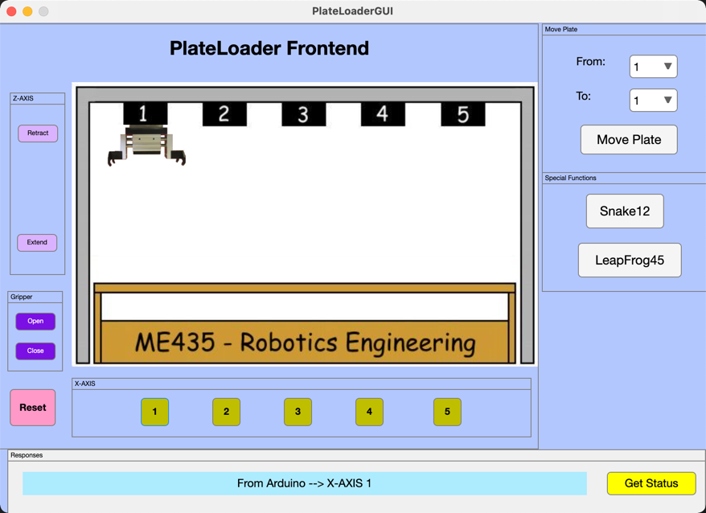
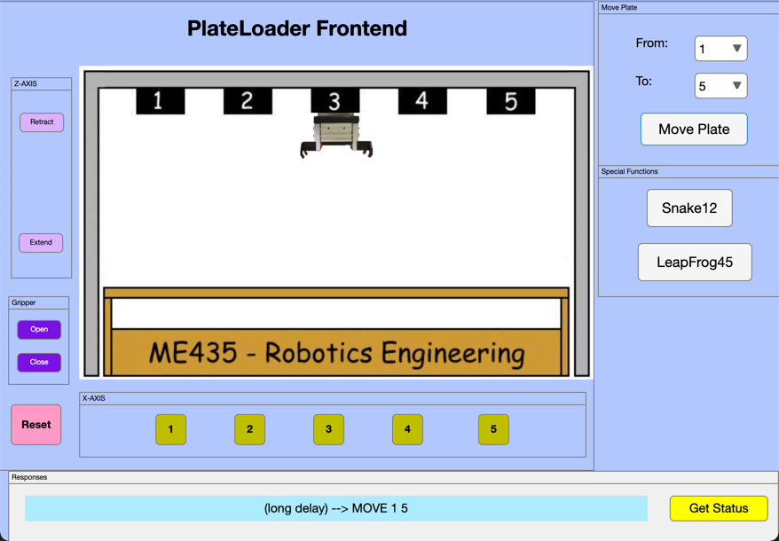

# PlateLoader Lab 3: Python Flask Server

In this lab, you will demo three different things that you have been building towards in the classroom.

- [ ] **Part A: The Python Serial menu**
- [ ] **Part B: The HTML page**
- [ ] **Part C: MATLAB Frontend GUI Restful Calls**

## Table of Contents

- [Part A. - The Python Serial menu](#part-a---the-python-serial-menu)
- [Part B. - The HTML page](#part-b---the-html-page)
- [Part C. - MATLAB Frontend GUI Restful Calls](#part-c---matlab-frontend-gui-restful-calls)
- [Notes: Python Serial programming](#notes-python-serial-programming)
- [Notes: PlateLoader commands](#notes-plateloader-commands)
- [Notes: Sending commands from MATLAB](#notes-sending-commands-from-matlab)
- [Submitting your work](#submitting-your-work)

## Part A. - The Python Serial menu

The goal for this part of the lab is for you to demo **on a real plate loader** the Python serial menu that we've been developing together in class. You need to demo only four commands. Most students do:

1. RESET
2. X-AXIS
3. Z-AXIS
4. GRIPPER

You can do MOVE, LOADER_STATUS, or even a special move if you would like, but that is not required. We just want to see you demo using an ssh connection and a direct Pi to PlateLoader serial communication. This is a team checkoff using code we mostly finished in class. Either lab partner can do the demo, but make sure you both understand and either student could run it.

## Part B. - The HTML page

The goal for this part of the lab is for ~~you~~ **your professor** to demo your PlateLoader server using the web app that you made. This checkoff will happen on your instructor's computer using their Chrome browser. Test your web app on your own computer, but make sure it's running in a way that any computer could do the demo. Then simply tell them the IP address of your Pi (or the name if you've found that using the name works) to your instructor. Your website must have buttons (or some other mechanism) for all of the basics:

1. RESET
2. X-AXIS (to anywhere)
3. Z-AXIS (extend or retract)
4. GRIPPER (open or close)
5. MOVE (from anywhere to anywhere) ← probably **not** just buttons
6. LOADER_STATUS

Additionally, the response from the PlateLoader needs to be displayed on the web app. This is the finished, functional web app that you've got working based on code we've developed together in class.

## Part C. - MATLAB Frontend GUI Restful Calls

The goal for this part of the lab is for you to use your Python Flask server to communicate with a MATLAB frontend (instead of an HTML/CSS/JavaScript web client).



You will use the same GUI that you used in the prior lab, but this time you'll be wireless.

Since there are only 6 plate loaders and they are physically located on campus, you will not be expected to use a real plate loader as you develop this code, but we'd like for you to use a real plate loader to demo this code. In the end you will have a GUI that runs on your computer in MATLAB, that can be located anywhere on campus and control your Pi that is connected to a PlateLoader. If you did a remote test, you'd see the value of your simulator even more.

---

**The remainder of this document is just notes and comments that might help (or not). It is not required reading.**

---

## Notes: Python Serial programming

This lab is done on your Pi. As always you could use a monitor and mouse connected to your Pi, but most students use the Remote Development tool (VS Code extension). At this point you should have your Arduino connected to your Pi for testing, but planning to use a real PlateLoader for your demo.

We'll work on direct Python serial programming first. The Pi uses PySerial which is automatically installed. Here is the [PySerial documentation](https://pyserial.readthedocs.io/en/latest/) btw.

On the Raspberry Pi there are two ports we'll use:

- `/dev/ttyACM0` - the most common name of the Arduino
- `/dev/ttyUSB0` - the most common name of the PlateLoader

Warning: Just like COM ports the number can grow, `/dev/ttyACM0` can become `/dev/ttyACM1` if weird reconnection things happen.

Just plug your Arduino into your Pi via the USB and run this command on your Pi (probably via our SSH tools):

```bash
python -m serial.tools.miniterm
```

Miniterm is a built-in Serial tool for the Pi command line that comes with PySerial ([docs](https://pyserial.readthedocs.io/en/latest/tools.html#module-serial.tools.miniterm)). I like this command because it gives you a quick list of com ports on the Pi. You can select the `/dev/ttyACM0` option (it's probably 1 or 2). Unfortunately it won't do anything useful since the default baudrate for Miniterm is 9600 and the Arduino we programmed to 19200. So hit **Ctrl+] to exit** if you are connected, or Ctrl+c if you didn't select an option to connect to. We can learn how to fix the connection with a few command line flags. Try this command:

```bash
python -m serial.tools.miniterm --help
```

or you could look at the docs link above. We need some configuration flags. Here is the actual command that should work:

```bash
python -m serial.tools.miniterm /dev/ttyACM0 19200 -e --eol LF
```

This will connect you to that serial port and you can type commands. Try sending a few messages like `RESET` or `Z-AXIS EXTEND`. Try a (long delay) `MOVE 1 5` command as well. When you are done hit `Ctrl+]` to exit.

## Notes: PlateLoader commands

Here is a reminder of PlateLoader commands:

| COMMAND | PARAMETERS | ACTION | RESPONSE |
| --- | --- | --- | --- |
| **RESET** | (NONE) | The **Z-AXIS** is **RETRACTED**, the **GRIPPER** is **CLOSED**, and the **X-AXIS** is sent to *X-POSITION* **5** and then to *X-POSITION* **3**. | READY, SAGIAN PE LOADER, ROM VER. 1.1.6, 12APR2001<br>ERROR (See ERROR CODES) |
| **X-AXIS** *X-POSITION* | *X-POSITION*: **1\|2\|3\|4\|5** | The **Z-AXIS** is **RETRACTED**, the **X-AXIS** is sent to the specified *X-POSITION* | READY, SAGIAN PE LOADER, ROM VER. 1.1.6, 12APR2001 |
| **Z-AXIS** *Z-POSITION* | *Z-POSITION*: **EXTEND\|RETRACT** | The **Z-AXIS** is sent to the specified *Z-POSITION* and a serial response is returned. | READY<br>ERROR (See ERROR CODES) |
| **GRIPPER** *GRIPPER_POSITION* | *GRIPPER_POSITION*: **OPEN\|CLOSE** | The **GRIPPER** is sent to the specified *GRIPPER_POSITION* and a serial response is returned | READY, OPEN<br>READY, CLOSED, PLATE<br>READY, CLOSED, NO PLATE<br>ERROR (See ERROR CODES) |
| **MOVE** *UNLOAD_X-POSITION*, *LOAD_X-POSITION* | *UNLOAD_X-POSITION*: **1\|2\|3\|4\|5**<br>*LOAD_X-POSITION*: **1\|2\|3\|4\|5** | Moves a microplate from *UNLOAD_X-POSITION* to *LOAD_X-POSITION* and returns a serial response. | READY<br>ERROR (See ERROR CODES) |
| **LOADER_STATUS** | (NONE) | Returns the current *X-POSITION*, *Z-POSITION*, *GRIPPER_POSITION*, and *PLATE-STATUS* | BUSY<br>READY, POSITION *X-POSITION*, ZAXIS *Z-POSITION*, GRIPPER *GRIPPER_POSITION*, *PLATE_STATUS* |
| **SET_DELAY** *FROM_X-POSITION*, *TO_X-POSITION*, *DELAY* | *FROM_X-POSITION*: **1\|2\|3\|4\|5**<br>*TO_X-POSITION*: **1\|2\|3\|4\|5**<br>*DELAY* (in ms): **0 to 1500** | Delay time in milliseconds from when sensor trips to arm stops. Each individual move has a separate delay. | READY, TO *TO_X-POSITION*, FROM *FROM_X-POSITION*, DELAY |

## Notes: Sending commands from MATLAB

Note that a space character is not allowed in a URL so you have to use a `%20` as the URL encoded version of space if you go that route.

| Character | From UTF-8 |
| --- | --- |
| space | **%20** |

You could continue to test your API with Chrome using direct URL requests, but instead use MATLAB. MATLAB can send RESTful API requests just fine using `webread`. Try this script in MATLAB (putting in the Pi address or name for your Pi):

```matlab
clc
response = webread("http://10.0.1.57:5000/api/RESET")
% response = webread("http://10.0.1.57:5000/api/MOVE 1 5")
```

Try the second command and a few others from your server. Note that MATLAB takes care of URL encoding the space characters for you (even easier).

> **Heads up on timeouts:** `webread` gives up after **5 seconds** by default. A `MOVE` on a real PlateLoader (or a long delay on your Arduino) can easily take longer than that, so pass a longer timeout with `weboptions`:
>
> ```matlab
> options = weboptions("Timeout", 30);
> response = webread("http://10.0.1.57:5000/api/MOVE 1 5", options)
> ```

If you implemented the approach where you have only 1 API method, you could also try this MATLAB example:

```matlab
function response = sendCommand(command)
    options = weboptions("Timeout", 30);
    response = webread("http://10.0.1.57:5000/api/" + command, options);
    fprintf("Response to %s --> %s\n", command, response);
end
```

Use double quotes (`"..."`) for the URL and the command so they are MATLAB **strings** and `+` joins them. With single-quoted char arrays, `+` does arithmetic on the character codes instead of joining them.

See if you can run with it from here. You will have to merge this knowledge into your PlateLoader GUI + PlateLoader class from the in-class work to make a web controlled version! Hints: You already have classes called:

- `PlateLoader`
- `PlateLoaderSim`

Make a new one called `PlateLoaderFrontend`. Try to figure out how to use the send command above as a private function in the class to do sending. Hopefully, it will be pretty straightforward to swap in GET calls for your serial messaging:

```matlab
function response = sendCommand(obj, command)
    options = weboptions("Timeout", 30);
    response = webread("http://10.0.1.57:5000/api/" + command, options);
    fprintf("Response to %s --> %s\n", command, response);
end
```

Once complete you will be able to run a MATLAB GUI from your computer and click buttons to send all the commands to the Pi, then your Pi will send the commands to the PlateLoader. It will be very similar to the version you had connected to the robot in class, just wireless. For example, here my GUI moved to X position 1...



Note the response from the Arduino is shown in my blue response area, I'm not using a real PlateLoader for this demo (obvious from the response). Here I'll do a move command...



Again you can see the response from my Arduino. Also after a move command the robot is back at position 3. So my messages go... Computer (MATLAB) → Pi server → PlateLoader ... PlateLoader → Pi server → Computer (MATLAB)

Then I tried it on a real PlateLoader, and it looked like this...


## Submitting your work

Run these parts on a real plate loader during an ABC Day.
